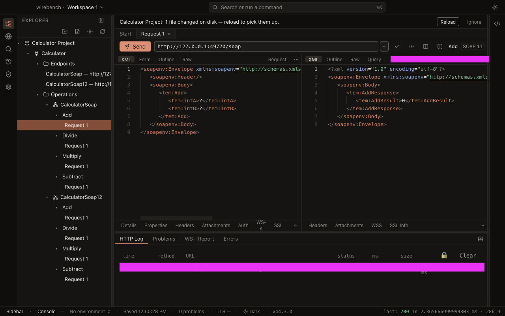

<div align="center">

# Wirebench

**A local-first API client and SSH workbench: SOAP, REST, gRPC, GraphQL, WebSocket and MCP in one desktop app.**

[](https://github.com/wirebench/wirebench/actions/workflows/ci.yml)
[](https://github.com/wirebench/wirebench/releases/latest)
[](LICENSE)
[](packages/server/LICENSE)

[Download](https://wirebench.github.io/wirebench/download/) ·
[User guide](https://wirebench.github.io/wirebench/docs/) ·
[Features](https://wirebench.github.io/wirebench/features/) ·
[Changelog](CHANGELOG.md)



</div>

- **Nothing leaves your machine.** No account, no telemetry, no update check unless you ask for one. A project is a
  folder of small YAML and XML files you commit to git; secrets are encrypted with the operating system's keychain and
  never written into them.
- **The protocols the enterprise still runs.** SOAP with WS-Security, WS-Trust and Kerberos sits next to REST, gRPC,
  GraphQL, WebSocket and MCP servers, in one project with one set of environments, one history and one HTTP stack.
- **Agent-ready, not AI-washed.** The `wirebench` CLI runs saved requests in CI, and `wirebench mcp` lets a coding agent
  import, generate, send, validate and query over the Model Context Protocol. No model runs inside the app.
  [Use Wirebench from your coding agent](https://wirebench.github.io/wirebench/docs/guides/coding-agents/) sets it up.
- **One window for the whole wire.** SSH hosts, terminals, SFTP, port forwarding and snippets live beside the API
  requests, so the service you call and the machine it runs on are in the same window.

## Install

Every release carries the version, the system and the processor in its file name. Get it from the
[download page](https://wirebench.github.io/wirebench/download/) or straight from the
[latest release](https://github.com/wirebench/wirebench/releases/latest); the
[installation guide](https://wirebench.github.io/wirebench/docs/getting-started/installation/) covers first-launch
prompts, silent installs and where your data lives.

- **macOS.** Open `Wirebench-<version>-mac-universal.dmg` and drag Wirebench into Applications. Builds are signed and
  notarised.
- **Windows.** Run `Wirebench-<version>-windows-x64-setup.exe` (per-user, no administrator rights), or deploy the
  `.msi` to a fleet with `msiexec /i Wirebench-<version>-windows-x64.msi /qn`. A portable `.zip` runs without
  installing. Windows builds are not code-signed yet, so SmartScreen asks once.
- **Linux.** An AppImage, `.deb`, `.rpm` and `.snap` are published for x86-64, the AppImage and `.deb` for arm64 too:

  ```bash
  sudo apt install ./wirebench_<version>_amd64.deb
  ```

On macOS and Windows a package manager installs and upgrades the app too (the winget listing is pending review):

```bash
brew install --cask wirebench/tap/wirebench
```

```powershell
winget install Wirebench.Wirebench
```

The command line runs the same project files in a pipeline, as a GitHub Action, a GitLab template, a container image
or plain `npx`:

```bash
npx --yes @wirebench/cli run ./project --env staging --reporter junit=reports/wirebench.xml
```

## Run a team server

Wirebench Server adds sign-in with local accounts, OpenID Connect or SAML, teams and roles, shared workspaces with live
updates, team secrets, webhook catch URLs, an audit log and scheduled runs. One process and one PostgreSQL database,
self-hosted behind your own TLS. The Community edition is free for five seats; Team and Enterprise licenses add more.

```bash
docker compose -f packages/server/compose.yaml up
```

The [server guide](https://wirebench.github.io/wirebench/docs/guides/wirebench-server/) and the
[server README](packages/server/README.md) cover the image, configuration and operations;
[editions and licenses](https://wirebench.github.io/wirebench/docs/guides/server-licensing/) explains the seats. The
desktop app never requires a server.

## Documentation

- [User guide](https://wirebench.github.io/wirebench/docs/): installation, a ten-minute walkthrough, a guide per
  feature, reference and troubleshooting.
- [Run in CI](https://wirebench.github.io/wirebench/docs/guides/run-in-ci/),
  [Agents over MCP](https://wirebench.github.io/wirebench/docs/guides/agents-mcp/) and the [CLI reference](docs/cli.md).
- [Hosts and terminals](https://wirebench.github.io/wirebench/docs/guides/hosts-and-terminals/) for the SSH workbench.
- [Architecture overview](docs/architecture/overview.md), [decision records](docs/adr/) and the
  [security model](docs/security.md) for how it is built.

## Roadmap

Open work is tracked as issues in [milestones](https://github.com/wirebench/wirebench/milestones). The
[roadmap](docs/roadmap.md) argues the order and records what each release carried.

## Contributing

Issues and pull requests are welcome; read [CONTRIBUTING.md](CONTRIBUTING.md) first. It covers the pnpm monorepo
(`packages/engine`, `packages/cli`, `packages/server`, `apps/desktop`), the `pnpm check` gate, testing conventions and
how to add a protocol. To build from source you need [Node 24](https://nodejs.org) and pnpm 9 (`corepack enable`):

```bash
git clone https://github.com/wirebench/wirebench.git
cd wirebench
pnpm install
pnpm dev
```

To report a vulnerability, follow the reporting note in the [security model](docs/security.md) rather than opening a
public issue.

## License

[Apache-2.0](LICENSE) for the desktop app, the engine, the CLI, the SSH package, the integrations, the site and
the docs. The one exception is Wirebench Server, `packages/server`, which is under the
[Elastic License 2.0](packages/server/LICENSE): free to run for your own company and to modify, not to offer to
third parties as a hosted service, and not to run with the license check circumvented
([ADR-0028](docs/adr/0028-the-server-is-licensed-under-the-elastic-license-2-0.md)). Wirebench is a clean-room
implementation built from public specifications; no code from other SOAP tools is copied into it. Bundled
third-party packages and their notices are listed in [THIRD-PARTY-LICENSES.md](THIRD-PARTY-LICENSES.md) and
shipped in every installer.
